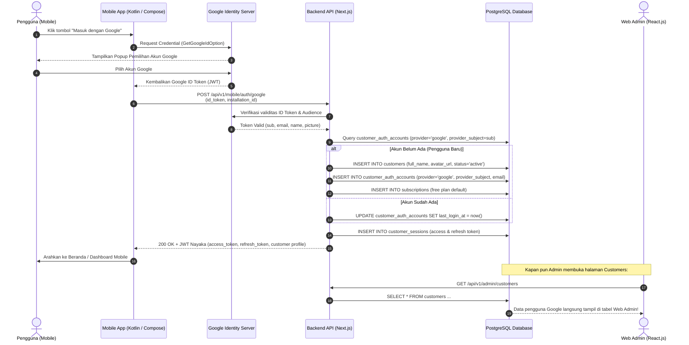

# 📋 Panduan Konsep Arsitektur: Integrasi Google Sign-In (Mobile Kotlin & Web React/Next.js)

Dokumen ini berisi penjelasan konseptual, alur sistem, serta panduan teknis pembagian tugas (*task distribution*) antara **Tim Mobile (Kotlin)** dan **Tim Web/Backend (React.js / Next.js)** untuk mengimplementasikan fitur **Login dengan Google (Google Sign-In)**.

---

## 1. Ringkasan Eksekutif & Kondisi Sistem

### Kondisi Saat Ini (As-Is)
* Admin di Web Admin mendaftarkan akun customer secara manual melalui form tambah pelanggan (menghasilkan record `email` dan kata sandi di database).
* Pengguna mobile hanya dapat masuk (*login*) menggunakan kombinasi email dan kata sandi yang telah didaftarkan.
* Hal ini menimbulkan *bottleneck* operasional karena setiap pengguna baru harus menunggu dibuatkan akun oleh admin.

### Kondisi yang Diharapkan (To-Be)
* Pengguna baru maupun pengguna lama dapat langsung menekan tombol **"Masuk dengan Google"** di aplikasi Android.
* Sistem otomatis melakukan *onboarding/self-registration* di latar belakang jika pengguna belum pernah terdaftar.
* Data profil pengguna baru (nama, email, foto profil) otomatis tersimpan ke database utama PostgreSQL dan **langsung muncul secara real-time di halaman Web Admin Customer**.

> [!NOTE]
> **Kabar Baik Arsitektur Database Anda:**
> Skema database Anda pada tabel `customer_auth_accounts` (`db/migrations/0003_customer_device.sql`) **sudah memiliki kolom `provider` bertipe check (`'email', 'whatsapp', 'google'`)** dan kolom `provider_subject`.
> Ini berarti struktur database inti **sudah siap mendukung Google Auth**, sehingga tim backend tidak perlu melakukan perombakan skema tabel besar-besaran!

---

## 2. Diagram Alur Kerja (End-to-End Flow)

Berikut adalah diagram alur interaksi antara **Mobile App**, **Google Identity Services**, **Backend API**, dan **Web Admin**:



---

## 3. Tugas & Perubahan untuk Tim Mobile (Kotlin - Android)

Tim mobile bertanggung jawab untuk memicu pemilihan akun Google di perangkat pengguna dan mengirimkan `id_token` yang diperoleh ke backend.

### A. Konfigurasi Dependensi Gradle
Gunakan pustaka resmi dan modern dari Google, yaitu **AndroidX Credential Manager** (menggantikan GoogleSignInClient lawas):

```kotlin
// libs.versions.toml atau build.gradle.kts (app)
dependencies {
    implementation("androidx.credentials:credentials:1.3.0")
    implementation("androidx.credentials:credentials-play-services-auth:1.3.0")
    implementation("com.google.android.libraries.identity.googleid:googleid:1.1.1")
}
```

### B. Perubahan pada UI (`LoginScreen.kt` & `RegisterScreen.kt`)
1. Tambahkan pembatas teks `— ATAU —`.
2. Tambahkan tombol sekunder / outlined button: **"Lanjutkan dengan Google"** lengkap dengan ikon resmi Google di bawah tombol login utama.

### C. Alur Kode di Kotlin (ViewModel / Coroutine)
1. **Inisialisasi Credential Manager**:
   ```kotlin
   val credentialManager = CredentialManager.create(context)
   
   val googleIdOption = GetGoogleIdOption.Builder()
       .setFilterByAuthorizedAccounts(false)
       .setServerClientId(WEB_CLIENT_ID) // Client ID bertipe Web Application dari Google Cloud Console
       .setAutoSelectEnabled(false)
       .build()

   val request = GetCredentialRequest.Builder()
       .addCredentialOption(googleIdOption)
       .build()
   ```
2. **Menjalankan Request & Mengambil ID Token**:
   ```kotlin
   val result = credentialManager.getCredential(request = request, context = context)
   val credential = result.credential
   
   if (credential is CustomCredential && credential.type == GoogleIdTokenCredential.TYPE_GOOGLE_ID_TOKEN_CREDENTIAL) {
       val googleIdTokenCredential = GoogleIdTokenCredential.createFrom(credential.data)
       val idToken = googleIdTokenCredential.idToken
       
       // Kirim ke Backend API
       viewModelScope.launch {
           repository.loginGoogle(idToken)
       }
   }
   ```
3. **Penyimpanan Sesi**:
   * Metode `repository.loginGoogle(idToken)` yang sudah tersedia di repository aplikasi tinggal menyimpan `access_token` dan `refresh_token` ke dalam `EncryptedSharedPreferences` (`TokenManager`), sama seperti login manual saat ini.

---

## 4. Tugas & Perubahan untuk Tim Backend & Web (Next.js / React)

Tim web/backend bertanggung jawab untuk menyediakan endpoint penerima token Google, melakukan verifikasi kriptografis, serta memastikan data tersimpan ke tabel database yang dibaca oleh Web Admin.

### A. Endpoint Baru Mobile API: `POST /api/v1/mobile/auth/google`
* Lokasi file: `src/app/api/v1/mobile/auth/google/route.ts`
* Request Body:
  ```json
  {
    "id_token": "eyJhbGciOiJSUzI1NiIsIm...",
    "installation_id": "c1f7b02d-4589-4e76-86c5-c266665792ec",
    "platform": "android",
    "app_version": "1.0.0"
  }
  ```

### B. Verifikasi ID Token Google di Backend
Gunakan library `google-auth-library` untuk memvalidasi token secara aman:

```bash
npm install google-auth-library
```

Contoh logika verifikasi di file layanan (`src/lib/server/mobile.ts`):
```typescript
import { OAuth2Client } from "google-auth-library";

const googleClient = new OAuth2Client(process.env.GOOGLE_CLIENT_ID);

export async function verifyGoogleToken(idToken: string) {
  const ticket = await googleClient.verifyIdToken({
    idToken,
    audience: process.env.GOOGLE_CLIENT_ID, // Harus cocok dengan Server Client ID
  });
  
  const payload = ticket.getPayload();
  if (!payload || !payload.email) {
    throw new AppError({ code: "INVALID_CREDENTIALS", message: "Token Google tidak valid." });
  }
  
  return {
    googleSubject: payload.sub,
    email: payload.email,
    fullName: payload.name ?? "Pengguna Google",
    avatarUrl: payload.picture ?? null,
    isEmailVerified: payload.email_verified ?? false,
  };
}
```

### C. Logika Database & Sinkronisasi Customer (*Upsert Logic*)
Gunakan transaksi database PostgreSQL (`withTransaction`):
1. **Cek Akun Google**:
   * Cek apakah `customer_auth_accounts` sudah memiliki baris dengan `provider = 'google'` dan `provider_subject = googleSubject`.
   * Jika ada: Ambil `customer_id`-nya.
2. **Cek Berdasarkan Email (Linking)**:
   * Jika `googleSubject` belum ada, cek apakah `email` pengguna sudah pernah didaftarkan (misal oleh Admin sebelumnya).
   * Jika ada: Tautkan akun Google tersebut ke `customer_id` yang sudah ada dengan menambahkan baris baru di `customer_auth_accounts` (`provider = 'google'`, `provider_subject = googleSubject`).
3. **Pengguna Baru (Auto-Register)**:
   * Jika email belum pernah ada sama sekali:
     * `INSERT INTO customers (full_name, avatar_url, status) VALUES ($1, $2, 'active') RETURNING id`
     * `INSERT INTO customer_auth_accounts (customer_id, provider, provider_subject, email, is_verified, verified_at) VALUES ($1, 'google', $2, $3, true, now())`
     * `INSERT INTO subscriptions (...)` daftarkan paket *free* awal secara otomatis.
4. **Terbitkan Sesi**:
   * Panggil fungsi `issueSession(customerId, input)` yang sudah ada untuk membuat JWT dan refresh token mobile.

### D. Dampak Terhadap Web Admin (`/admin/customers`)
* **Otomatis Muncul**: Karena Web Admin melakukan query langsung ke tabel `customers` dan melakukan agregasi provider dari `customer_auth_accounts`:
  ```sql
  SELECT array_agg(a.provider ORDER BY a.provider) FROM customer_auth_accounts a WHERE a.customer_id = c.id AS providers
  ```
  Pengguna baru yang login via Google akan **langsung otomatis muncul di daftar pelanggan**.
* **Penyempurnaan UI Admin (Opsional / Minor)**:
  * Tambahkan *badge* ikon/teks "Google" pada kolom **Metode Masuk / Provider** di tabel pelanggan web admin.
  * Tampilkan `avatar_url` (foto profil akun Google) pada baris tabel pelanggan jika tersedia.

---

## 5. Prasyarat Konfigurasi: Google Cloud Console

Kedua tim (atau Tech Lead/DevOps) perlu menyiapkan akun Google Cloud:

1. Buka [Google Cloud Console](https://console.cloud.google.com/) -> Buat Project (misal: `Nayaka CCTV`).
2. Masuk ke **APIs & Services** -> **OAuth consent screen**:
   * Pilih tipe User: **External**.
   * Isi Nama Aplikasi (*Nayaka CCTV*), Email Dukungan Pengembang, dan Domain/Kebijakan Privasi.
3. Buat **Credentials** (Kredensial OAuth 2.0):
   * **Kredensial 1: Web Application (Sangat Penting)**:
     * Diberi nama: `Nayaka Web / Backend Client`.
     * Simpan `Client ID` dan `Client Secret`.
     * *Catatan:* Nilai `Client ID` ini yang akan digunakan oleh Backend untuk memverifikasi token dan oleh Android sebagai `serverClientId`.
   * **Kredensial 2: Android**:
     * Diberi nama: `Nayaka Android Client`.
     * Masukkan **Package Name**: `com.nayakacctv`.
     * Masukkan **SHA-1 Certificate Fingerprint** dari keystore lokal pengembang (`debug.keystore`) dan keystore produksi (`release.keystore`).

---

## 6. Matriks Pembagian Tugas Antar Tim

| Modul / Komponen | Penanggung Jawab | Deskripsi Tugas |
| :--- | :--- | :--- |
| **Google Cloud Setup** | Project Lead / DevOps | Membuat Project di Google Cloud Console, OAuth Consent Screen, dan 2 OAuth Client ID (Web & Android). |
| **Android UI & Auth** | Tim Mobile (Kotlin) | Memasang pustaka Credential Manager, membuat tombol "Masuk dengan Google" di Jetpack Compose, dan mengarahkan flow login. |
| **Android API Call** | Tim Mobile (Kotlin) | Mengirim `id_token` ke endpoint backend via `ApiService.loginGoogle()` dan menyimpan token sesi. |
| **Backend API Route** | Tim Web (Next.js) | Membuat route handler `POST /api/v1/mobile/auth/google`. |
| **Backend Verification** | Tim Web (Next.js) | Verifikasi integritas token Google menggunakan `google-auth-library`. |
| **Database Sync Logic** | Tim Web (Next.js) | Logika *find-or-create* customer di PostgreSQL, link provider, dan auto-subscribe free plan. |
| **Admin UI Enhancement** | Tim Web (React.js) | Menambahkan badge provider `Google` dan avatar pada tabel `/admin/customers`. |

---

## 7. Rekomendasi Alur Transisi & Keamanan

1. **Email Linking Safety**:
   * Jika admin sebelumnya telah mendaftarkan email `user@gmail.com` secara manual, lalu pengguna tersebut mencoba login lewat tombol Google dengan email yang sama, sistem secara otomatis menautkan akun Google tersebut ke akun yang sudah ada. Pengguna tidak perlu khawatir kehilangan data perangkat CCTV atau histori langganan.
2. **Penanganan Status Pelanggan**:
   * Jika admin pernah menangguhkan (*suspend*) akun customer tertentu di web admin, verifikasi Google di backend harus tetap memeriksa `status != 'suspended'`. Jika berstatus *suspended*, tolak login dengan kode error `CUSTOMER_SUSPENDED`.
3. **Penyimpanan Secret yang Aman**:
   * `GOOGLE_CLIENT_ID` dan `GOOGLE_CLIENT_SECRET` disimpan di file `.env` server backend dan tidak boleh di-hardcode di dalam kode sumber aplikasi Android. Aplikasi Android hanya memerlukan `WEB_CLIENT_ID` (publik) untuk meminta token ID.
